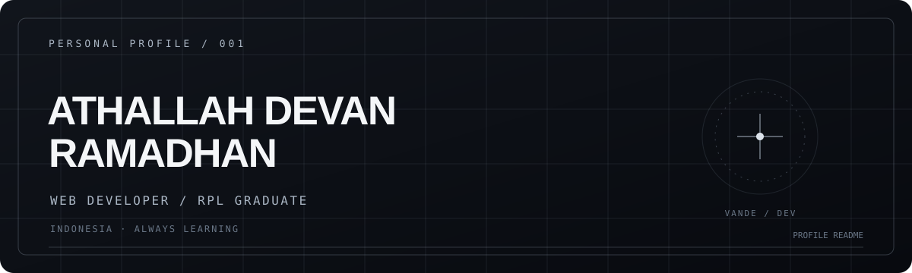

  

  <strong>Web Developer · RPL Graduate · Indonesia</strong> 
  Building useful digital experiences and continuously learning.

  <a href="https://github.com/jyutomc-cloud">GitHub Profile</a>
  &nbsp;·&nbsp;
  <a href="https://eaide.vercel.app">EAIDE</a>
  &nbsp;·&nbsp;
  <a href="https://vaanmusic.vercel.app">Vaan Music</a>

## GitHub Statistics

<table>
  <tr>
    <td width="50%" align="center">
      
    </td>
    <td width="50%" align="center">
      
    </td>
  </tr>
</table>

  

## Tech Stack

  
  
  
  
  
  
  
  
  

